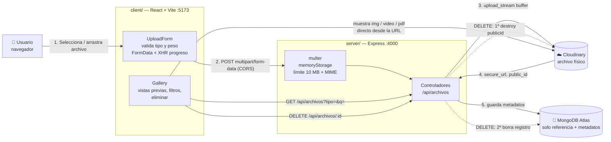

# ☁️ Cloud Media Vault

Gestor de activos multimedia en la nube. Permite **subir imágenes, videos y documentos PDF** a
**Cloudinary** y guardar sus **metadatos** (URL pública, `publicId`, nombre, tamaño, tipo MIME,
fecha y autor) en **MongoDB Atlas** mediante una **API REST** en Express, con una interfaz en
**React + Vite**.

> Taller Práctico Colaborativo — *Desarrollo de Experiencias Multimedia para la Web*
> Universidad Autónoma de Occidente (UAO)

---

## Integrantes y roles

| Integrante | Usuario GitHub | Rol | Responsabilidades |
|---|---|---|---|
| Sebastian Montaño | [@Sebastian-Montano](https://github.com/Sebastian-Montano) | **Rol 1 — Arquitecto Cloud y Base de Datos** | Cuentas de Cloudinary y MongoDB Atlas, modelo de metadatos, variables de entorno |
| David Elias Castro | [@tacodellama](https://github.com/tacodellama) | **Rol 2 — Backend: Ingesta y Subida Cloud** | `POST /api/archivos`, multer, validación de peso, tipo MIME y firma del archivo, subida a Cloudinary, manejo de errores |
| Miguel Jimenez | [@chanclaxx](https://github.com/chanclaxx) | **Rol 3 — Backend: Persistencia CRUD y Sincronización** | Guardado de metadatos con rollback, `GET /api/archivos` con filtros y orden, `DELETE /api/archivos/:id` sincronizado |
| Mariana Aristizabal | [@Mariaristi](https://github.com/Mariaristi) | **Rol 4 — Frontend: Formulario de Carga y Validaciones** | Drag & Drop, `FormData`, validación previa, vista previa, barra de progreso, alertas |
| Alejandro Gonzalez | [@auchija](https://github.com/auchija) | **Rol 5 — Frontend: Galería, Filtros y QA** | Galería con vistas previas, metadatos, filtros, eliminación reactiva, pruebas de integración |

---

## Funcionalidades

- **Carga validada** de imágenes (JPG, PNG, WEBP, GIF), videos (MP4, WEBM, MOV) y PDF de hasta **10 MB**,
  con **Drag & Drop**, vista previa antes de subir, **barra de progreso** real y alertas de éxito o error.
- **Doble validación**: en el navegador (experiencia de usuario) y en el servidor (seguridad): tamaño,
  tipo MIME y **firma real del archivo** (un `.exe` renombrado a `.png` se rechaza).
- **Almacenamiento dual desacoplado**: el archivo vive solo en Cloudinary; MongoDB guarda solo la
  referencia (`url`, `publicId`) y los metadatos.
- **Galería** con vista previa nativa según el tipo (``, `<video controls>`, miniatura de la primera
  página del PDF), peso formateado en KB/MB, tipo, fecha de subida y autor.
- **Filtros** por tipo de archivo y **búsqueda por título**.
- **Eliminación sincronizada**: primero en Cloudinary y después en MongoDB; la tarjeta desaparece al
  instante sin recargar la página.
- Diseño **responsivo** con modo claro y oscuro.

---

## Arquitectura

Ruta elegida: **Ruta B — Desacoplada Cliente-Servidor**.



**Explicación**

- **Subida (POST):** el navegador envía `multipart/form-data`. `multer` lo recibe **en memoria** (no se
  escribe en el disco del servidor), valida tamaño (≤ 10 MB) y tipo MIME; el servidor comprueba además la
  firma binaria del archivo. El buffer se envía a Cloudinary y, con su respuesta, se crea el documento en
  MongoDB. Si guardar en la base de datos falla, se borra lo subido a Cloudinary (rollback) para no dejar
  archivos huérfanos.
- **Consulta (GET):** lista ordenada por fecha (más reciente primero) con filtros por tipo y búsqueda por
  título, apoyada en índices de MongoDB.
- **Eliminación (DELETE):** primero se borra en Cloudinary con el `publicId`; **solo si eso funciona** se
  borra el registro en MongoDB. Si la nube falla, el registro se conserva para poder reintentar.
- **Seguridad:** CORS solo permite el origen del frontend; las credenciales están en `server/.env` (fuera
  de Git) y nunca llegan al navegador.

### Stack

| Capa | Tecnología |
|---|---|
| Frontend | React 19, Vite 8, CSS |
| Backend | Node.js 22+, Express 5, multer 2, cors |
| Almacenamiento de archivos | Cloudinary (capa gratuita) — SDK `cloudinary` v2 |
| Base de datos de metadatos | MongoDB Atlas M0 (capa gratuita) — ODM Mongoose 9 |

### Modelo de metadatos (colección `archivos`)

| Campo | Tipo | Descripción |
|---|---|---|
| `id` | ObjectId | Identificador |
| `titulo` | String | Título visible (máx. 120 caracteres) |
| `nombreOriginal` | String | Nombre del archivo subido |
| `url` | String | URL pública (https) en Cloudinary |
| `publicId` | String | ID del recurso en Cloudinary (único, para eliminar) |
| `resourceType` | String | `image` / `video` / `raw` (requerido por Cloudinary para eliminar) |
| `tipoArchivo` | String | `imagen` / `video` / `pdf` |
| `mimeType` | String | Tipo MIME (ej. `image/png`) |
| `tamanoBytes` | Number | Tamaño en bytes |
| `fechaSubida` | Date | Fecha de subida |
| `subidoPor` | String | Autor |

Índices: `fechaSubida` (descendente), `tipoArchivo` y texto en `titulo`.

---

## API REST

URL base en desarrollo: `http://localhost:4000`. Todas las respuestas son JSON:

```json
{ "ok": true, "data": ... }
{ "ok": false, "error": { "codigo": "ARCHIVO_MUY_GRANDE", "mensaje": "El archivo supera el límite de 10 MB." } }
```

| Método | Ruta | Descripción |
|---|---|---|
| `GET` | `/api/health` | Estado del servidor |
| `POST` | `/api/archivos` | Sube un archivo (`multipart/form-data`: `archivo`, `subidoPor`, `titulo` opcional) |
| `GET` | `/api/archivos?tipo=&q=&orden=` | Lista con filtros: `tipo` = `imagen`/`video`/`pdf`, `q` = texto del título, `orden` = `reciente`/`antiguo` |
| `DELETE` | `/api/archivos/:id` | Elimina en Cloudinary y luego en la base de datos |

| Código | Significado |
|---|---|
| `201` | Archivo subido y guardado |
| `400` | Falta el archivo o el autor, filtro inválido o `id` inválido |
| `404` | El archivo no existe |
| `413` | El archivo supera 10 MB |
| `415` | Tipo de archivo no permitido o contenido que no coincide con su tipo |
| `502` | Error de Cloudinary (en DELETE el registro no se borra) |
| `500` | Error interno |

Ejemplo:

```bash
curl -X POST http://localhost:4000/api/archivos \
  -F "archivo=@foto.jpg" -F "titulo=Mi foto" -F "subidoPor=Tu Nombre"
```

---

## Instrucciones de ejecución

### Requisitos

- [Node.js](https://nodejs.org/) **22.12 o superior** (`node -v`)
- Cuenta gratuita de [Cloudinary](https://cloudinary.com/) y de [MongoDB Atlas](https://www.mongodb.com/atlas)

### 1. Clonar

```bash
git clone https://github.com/chanclaxx/cloud-media-vault.git
cd cloud-media-vault
```

### 2. Variables de entorno

```bash
cp server/.env.example server/.env
cp client/.env.example client/.env
```

En Windows (PowerShell): `Copy-Item server/.env.example server/.env` y lo mismo para `client`.

Completar `server/.env`:

| Variable | Dónde se obtiene |
|---|---|
| `MONGODB_URI` | Atlas → *Database* → *Connect* → *Drivers* |
| `CLOUDINARY_CLOUD_NAME`, `CLOUDINARY_API_KEY`, `CLOUDINARY_API_SECRET` | Cloudinary → *Settings* → *API Keys* |
| `CORS_ORIGIN` | `http://localhost:5173` (frontend) |
| `CLOUDINARY_FOLDER` | Carpeta de Cloudinary donde se guardan los archivos |

> ⚠️ Los archivos `.env` **no se suben** a GitHub (están en `.gitignore`).

**Configuración necesaria en los paneles:**
- Cloudinary → *Settings* → *Security* → activar **"Allow delivery of PDF and ZIP files"**.
- Atlas → *Network Access* → agregar `0.0.0.0/0` (o la IP desde donde se ejecuta el servidor).

### 3. Instalar dependencias

```bash
cd server && npm install
cd ../client && npm install
```

### 4. Ejecutar (dos terminales)

```bash
cd server
npm run dev
```

```bash
cd client
npm run dev
```

Abrir **http://localhost:5173**. Comprobar la API en http://localhost:4000/api/health

### Problemas comunes

| Síntoma | Solución |
|---|---|
| `blocked by CORS policy` | El servidor no está corriendo o `CORS_ORIGIN` no coincide con `http://localhost:5173`. |
| `bad auth` al conectar a MongoDB | Usuario o contraseña de la base de datos incorrectos en `MONGODB_URI`. |
| `tlsv1 alert internal error` o timeout con MongoDB | La IP actual no está en *Network Access* de Atlas. |
| `querySrv ECONNREFUSED` | El DNS del equipo no resuelve direcciones `mongodb+srv://`: cambiar el DNS a `8.8.8.8` o usar la cadena de conexión sin `+srv` que ofrece Atlas. |
| El PDF no abre (401) | Activar "Allow delivery of PDF and ZIP files" en Cloudinary. |
| `Port 5173 is already in use` | Cerrar la otra instancia de Vite. |

---

## Estructura del proyecto

```
.
├── README.md
├── server/                       # API REST (Express)
│   ├── .env.example
│   ├── package.json
│   └── src/
│       ├── index.js              # arranque
│       ├── app.js                # Express: CORS, rutas, errores
│       ├── config/               # variables de entorno, MongoDB, Cloudinary
│       ├── constants/            # tipos MIME permitidos y límite de 10 MB
│       ├── controllers/          # lógica de /api/archivos
│       ├── middlewares/          # multer, manejador de errores
│       ├── models/               # esquema Mongoose "Archivo"
│       ├── routes/               # rutas /api/archivos
│       ├── services/             # subir / eliminar en Cloudinary
│       └── utils/                # errores HTTP, verificación de firma
└── client/                       # Interfaz (React + Vite)
    ├── .env.example
    ├── package.json
    ├── index.html
    └── src/
        ├── App.jsx
        ├── components/
        │   ├── upload/           # formulario, drag & drop, progreso
        │   ├── gallery/          # galería, tarjetas, vista previa, filtros
        │   └── ui/               # alertas, spinner
        ├── constants/
        ├── services/api.js       # llamadas a la API
        └── utils/formato.js      # KB/MB y fechas
```
