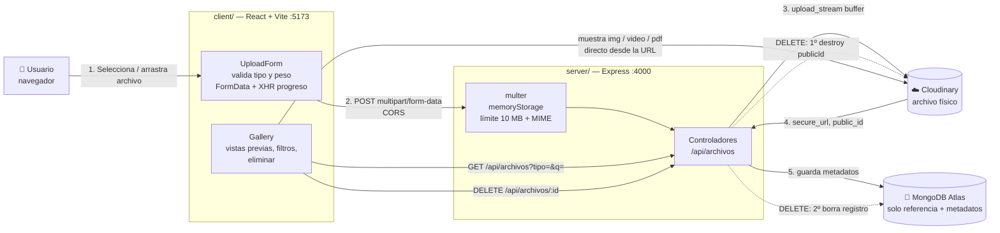

# ☁️ Cloud Media Vault

Gestor de activos multimedia en la nube. Permite **subir imágenes, videos y documentos PDF** a
**Cloudinary** y guardar sus **metadatos** (URL pública, `publicId`, nombre, tamaño, tipo MIME,
fecha y autor) en **MongoDB Atlas** mediante una **API REST** en Express, con una interfaz en
**React + Vite**.

> Taller Práctico Colaborativo — *Desarrollo de Experiencias Multimedia para la Web*
> Universidad Autónoma de Occidente (UAO)

---

## Integrantes y roles

> ✏️ **Cada integrante llena su fila** (y la sube en su propio commit).

| Integrante | Usuario GitHub | Rol | Responsabilidades |
|---|---|---|---|
| _Nombre Apellido_ | `@usuario` | **Rol 1 — Arquitecto Cloud y Base de Datos** | Cuentas de Cloudinary y MongoDB Atlas, modelo de metadatos, variables de entorno |
| _Nombre Apellido_ | `@usuario` | **Rol 2 — Backend: Ingesta y Subida Cloud** | `POST /api/archivos`, multer, validación de peso/MIME, subida a Cloudinary, manejo de errores |
| _Nombre Apellido_ | `@usuario` | **Rol 3 — Backend: Persistencia CRUD y Sincronización** | Guardado de metadatos, `GET /api/archivos` con filtros, `DELETE /api/archivos/:id` sincronizado |
| _Nombre Apellido_ | `@usuario` | **Rol 4 — Frontend: Formulario de Carga y Validaciones** | Drag & Drop, `FormData`, validación previa, barra de progreso, alertas |
| _Nombre Apellido_ | `@usuario` | **Rol 5 — Frontend: Galería, Filtros y QA** | Galería con vistas previas, metadatos, filtros, eliminación reactiva, pruebas de integración |

*(Si el equipo es de 4, los Roles 4 y 5 se fusionan en un único rol de UI/UX y Galería.)*

Detalle de tareas por rol: [docs/ROLES.md](docs/ROLES.md) · Avance: [docs/ESTADO.md](docs/ESTADO.md)

---

## Arquitectura

Elegimos la **Ruta B — Desacoplada Cliente-Servidor**:



**Explicación**

- **Almacenamiento dual desacoplado:** el archivo físico vive **solo** en Cloudinary. La base de datos
  guarda **solo** la referencia (`url`, `publicId`, `resourceType`) y los metadatos técnicos.
- **Subida (POST):** el navegador envía `multipart/form-data`. `multer` lo recibe **en memoria** (no se
  escribe en el disco del servidor), valida tamaño (≤ 10 MB) y tipo MIME, y el buffer se envía a
  Cloudinary. Con la respuesta de Cloudinary se crea el documento en MongoDB. Si guardar en la BD
  falla, se borra lo que se subió (rollback) para no dejar archivos huérfanos.
- **Consulta (GET):** lista ordenada por fecha (más reciente primero) con filtros por tipo y búsqueda
  por título, apoyada en índices.
- **Eliminación (DELETE):** primero se borra en Cloudinary con el `publicId`; **solo si eso funciona**
  se borra el registro en MongoDB. La interfaz quita la tarjeta al instante.
- **Seguridad:** CORS solo permite el origen del frontend; las credenciales están en `server/.env`
  (fuera de Git) y nunca llegan al navegador. Validaciones en cliente (UX) **y** en servidor (seguridad).

### Stack

| Capa | Tecnología |
|---|---|
| Frontend | React 19, Vite 8, CSS |
| Backend | Node.js 22+, Express 5, multer 2, cors |
| Almacenamiento de archivos | Cloudinary (capa gratuita) — SDK `cloudinary` v2 |
| Base de datos de metadatos | MongoDB Atlas M0 (capa gratuita) — ODM Mongoose 9 |

### Modelo de metadatos (`archivos`)

| Campo | Tipo | Descripción |
|---|---|---|
| `id` | ObjectId | Identificador |
| `titulo` | String | Título visible |
| `nombreOriginal` | String | Nombre del archivo subido |
| `url` | String | URL pública (https) en Cloudinary |
| `publicId` | String | ID del recurso en Cloudinary (para eliminar) |
| `resourceType` | String | `image` / `video` / `raw` (requerido por Cloudinary para eliminar) |
| `tipoArchivo` | String | `imagen` / `video` / `pdf` |
| `mimeType` | String | Tipo MIME (ej. `image/png`) |
| `tamanoBytes` | Number | Tamaño en bytes |
| `fechaSubida` | Date | Fecha de subida |
| `subidoPor` | String | Autor |

### API REST

| Método | Ruta | Descripción |
|---|---|---|
| `GET` | `/api/health` | Estado del servidor |
| `POST` | `/api/archivos` | Sube un archivo (`multipart/form-data`: `archivo`, `titulo`, `subidoPor`) |
| `GET` | `/api/archivos?tipo=&q=&orden=` | Lista ordenada con filtros |
| `DELETE` | `/api/archivos/:id` | Elimina en Cloudinary y luego en la BD |

Contrato completo (respuestas, códigos de error, ejemplos con `curl`): [docs/API.md](docs/API.md)

---

## Instrucciones de ejecución

### Requisitos

- [Node.js](https://nodejs.org/) **22.12 o superior** (`node -v`)
- Cuenta gratuita de [Cloudinary](https://cloudinary.com/) y de [MongoDB Atlas](https://www.mongodb.com/atlas)
  (las configura el Rol 1; el resto del equipo solo necesita las credenciales).

### 1. Clonar

```bash
git clone <URL-del-repositorio>
cd <carpeta-del-repositorio>
```

### 2. Variables de entorno

```bash
# Backend
cp server/.env.example server/.env
# Frontend
cp client/.env.example client/.env
```

En Windows (PowerShell): `Copy-Item server/.env.example server/.env` y lo mismo para `client`.

Llenar `server/.env` con las credenciales reales (las comparte el Rol 1 por un canal privado):

| Variable | Dónde se obtiene |
|---|---|
| `MONGODB_URI` | Atlas → *Database* → *Connect* → *Drivers* |
| `CLOUDINARY_CLOUD_NAME`, `CLOUDINARY_API_KEY`, `CLOUDINARY_API_SECRET` | Cloudinary → *Settings* → *API Keys* |
| `CORS_ORIGIN` | `http://localhost:5173` (frontend) |

> ⚠️ Los archivos `.env` **no se suben** a GitHub (están en `.gitignore`).

**Configuración necesaria en los paneles (Rol 1):**
- Cloudinary → *Settings* → *Security* → activar **"Allow delivery of PDF and ZIP files"**.
- Atlas → *Network Access* → agregar `0.0.0.0/0` (o la IP de cada integrante).

### 3. Instalar dependencias

```bash
cd server && npm install
cd ../client && npm install
```

### 4. Ejecutar (dos terminales)

```bash
# Terminal 1 — API en http://localhost:4000
cd server
npm run dev
```

```bash
# Terminal 2 — Interfaz en http://localhost:5173
cd client
npm run dev
```

Abrir **http://localhost:5173**. Comprobar la API: http://localhost:4000/api/health

### Problemas comunes

| Síntoma | Solución |
|---|---|
| `blocked by CORS policy` | El server no está corriendo o `CORS_ORIGIN` no coincide con `http://localhost:5173`. |
| `bad auth` al conectar a MongoDB | Usuario/contraseña de la BD incorrectos en `MONGODB_URI`. |
| Timeout conectando a MongoDB | Tu IP no está en *Network Access* de Atlas. |
| El PDF no abre (401) | Activar "Allow delivery of PDF and ZIP files" en Cloudinary. |
| `Port 5173 is already in use` | Cerrar la otra instancia de Vite. |

---

## Estructura del proyecto

```
.
├── README.md
├── CLAUDE.md                     # reglas de trabajo del equipo (también las lee Claude Code)
├── docs/
│   ├── ENUNCIADO.md              # resumen del taller + checklist de la rúbrica
│   ├── ROLES.md                  # tareas y archivos de cada rol
│   ├── ESTADO.md                 # tablero de avance y bitácora
│   ├── API.md                    # contrato de la API REST
│   ├── FLUJO-GIT.md              # ramas, commits y pull requests
│   └── SUSTENTACION.md           # guion de la demo (8 min)
├── server/                       # API REST (Express)
│   ├── .env.example
│   ├── package.json
│   └── src/
│       ├── index.js              # arranque
│       ├── app.js                # Express: CORS, rutas, errores
│       ├── config/               # env, MongoDB, Cloudinary
│       ├── constants/            # tipos MIME permitidos y límite de 10 MB
│       ├── controllers/          # lógica de /api/archivos
│       ├── middlewares/          # multer, manejador de errores
│       ├── models/               # esquema Mongoose "Archivo"
│       ├── routes/               # rutas /api/archivos
│       ├── services/             # subir / eliminar en Cloudinary
│       └── utils/
└── client/                       # Interfaz (React + Vite)
    ├── .env.example
    ├── package.json
    ├── index.html
    └── src/
        ├── App.jsx
        ├── components/
        │   ├── upload/           # formulario, drag & drop, progreso
        │   ├── gallery/          # galería, tarjetas, vista previa, filtros
        │   └── ui/               # alertas, spinner
        ├── constants/
        ├── services/api.js       # llamadas a la API
        └── utils/formato.js      # KB/MB y fechas
```

---

## Cómo trabajamos

- Reglas del equipo (repo limpio, seguridad, commits): [CLAUDE.md](CLAUDE.md)
- Flujo de Git (ramas por rol, PRs, formato de commits): [docs/FLUJO-GIT.md](docs/FLUJO-GIT.md)
- **Las pruebas y experimentos se hacen fuera del repositorio.** El repo solo contiene código del proyecto.
